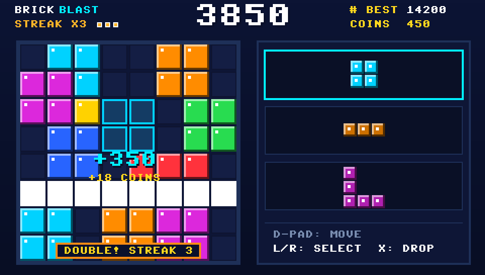

# Brick Blast (PSP Edition)

A lightweight, high-performance block-clearing puzzle game engineered specifically for the Sony PlayStation Portable (PSP). Built to run natively within the strict 32MB RAM constraints of original PSP-1000 hardware and modern emulators alike, **Brick Blast** delivers fluid 60 FPS gameplay, authentic audio scaling, and zero-latency input response.

<p align="center">
  
</p>

---

### Core Features

- **8×8 Grid Architecture:** Optimized tile-matching board engineered with direct VRAM double-buffering.
- **3-Block Dynamic Pool:** Spawns 3-piece sets with adaptive solvability guarantees and anti-lockout detection.
- **Fluid Line-Clearing Mechanics:** Simultaneous multi-row and multi-column clearing with glowing visual fanfare.
- **Harmonic Audio Streak Engine:** 10-note ascending audio scale mapped directly to consecutive clears.
- **Persistent Coin & Revive Economy:** Earn coins from streaks and clears; spend coins on scaled second-chance board revives saved directly to the Memory Stick.

---

## Hardware Controls

Designed natively for the standard PSP control layout:

| Button | Function |
| :--- | :--- |
| **D-Pad** | Move cursor / Highlight grid placement |
| **Cross ($\times$)** | Select piece / Confirm grid placement |
| **Circle ($\bigcirc$)** | Return piece to deck / Cancel placement |
| **L / R Triggers** | Cycle available pieces in deck |
| **Start** | Pause game / Open pause menu |
| **Select** | Restart run (from pause menu) |

---

## Installation for Players

Follow these steps to install and play on any PSP running Custom Firmware (PRO/ME/ARK) or via the PPSSPP emulator:

1. Download `BrickBlast_PSP.zip` from the [Releases](https://github.com/MBuTT3178/BrickBlast-PSP/releases) tab.
2. Connect your PSP to your PC via USB or insert your Memory Stick into a card reader.
3. Extract the contents of `BrickBlast_PSP.zip` directly to the root of your PSP's Memory Stick (e.g., `E:\` or `F:\`).
   - The archive is pre-structured to deploy directly to the required directory:
     ```text
     ms0:/PSP/GAME/BrickBlast/EBOOT.PBP
     ```
4. Safely disconnect your console, navigate to **Game $\rightarrow$ Memory Stick** on the PSP XMB menu, and boot **BrickBlast**.

---

## Compilation & Packaging for Developers

### Prerequisites

Ensure you have the official `pspdev` toolchain and libraries installed in your path:

- `pspdev` (MIPS GCC toolchain)
- `psp-sdl2` (Package manager library)

### Building from Source

Clone the repository and compile using the PSPSDK build system:

```bash
# Clone the repository
git clone https://github.com/MBuTT3178/BrickBlast-PSP.git
cd BrickBlast-PSP

# Compile binary and package relocatable PRX EBOOT
make
```

### Automated Package Generation

Generate the standalone distribution ZIP archive matching the release specification:

```bash
# Create target deployment folder structure
mkdir -p PSP/GAME/BrickBlast

# Copy the compiled executable
cp EBOOT.PBP PSP/GAME/BrickBlast/

# Package release zip
zip -r BrickBlast_PSP.zip PSP/
```

---

## License & Credits

- **License:** Released under the [MIT License](LICENSE).
- **Engine Credits:** Core logic matrices, adaptive placement solvers, and low-level hardware optimizations engineered using the **Antigravity Autonomous Agent framework**.
